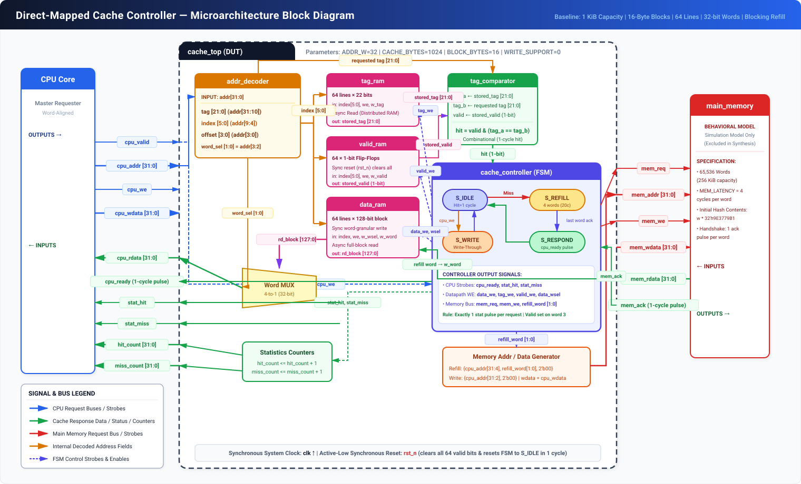

# Direct-Mapped Cache Controller in Verilog

[](rtl/)
[-brightgreen.svg)](tb/)
[](synth/)
[-purple.svg)](analysis/)
[-success.svg)](report/)
[](demo/)

A parameterized, synthesizable **Direct-Mapped Cache Controller** in Verilog with modular datapath hierarchy, Mealy/Moore controller FSM, behavioral main-memory interface, bit-accurate Python golden model, automated regression test suite, and comprehensive architectural performance analysis.

---

## 📌 Project Deliverables (Phase I & Phase II)

- 📄 **Final IEEE Project Report (PDF):** [`report/ieee_project_report.pdf`](report/ieee_project_report.pdf)
- 🖥️ **Interactive Presentation Demo (A → E Story):** [`demo/index.html`](demo/index.html) (Keynote-style 20-slide deck with live FSM, address decoder, 22-cycle handshake & cache simulators — ready for Vercel static hosting)
- 🎥 **Prototype Demo Video Link:** [Prototype Demonstration Video (Google Drive)](https://drive.google.com/drive/folders/1o7124f-L4o_MpETQ42nz_No1Ag2AnOtB?usp=sharing)
- 📊 **Architecture Block Diagram:** [`docs/architecture_block_diagram.svg`](docs/architecture_block_diagram.svg)
- 🎓 **Team Project Interview / Viva Guide:** [`docs/viva_guide.md`](docs/viva_guide.md)

---

## 👥 Group Members & Individual Contributions

| Milestone | Member Name | Role & Responsibility | Modules & Deliverables Owned |
|:---:|---|---|---|
| **M1** | **Pankaj Baid** *(Team Lead)* | System Architect & Controller FSM | `rtl/cache_controller.v`, `rtl/cache_top.v`, `docs/fsm.md`, `docs/address_breakdown.md` |
| **M2** | **Ashutosh Singh** | Storage Datapath Engineer | `rtl/addr_decoder.v`, `rtl/tag_ram.v`, `rtl/valid_ram.v`, `rtl/data_ram.v`, `rtl/tag_comparator.v`, M2 Unit Tests (`tb/tb_*.v`) |
| **M3** | **Narendra Singh** | Memory Interface & FPGA Synthesis | `rtl/main_memory.v`, `synth/synth.ys`, `synth/sweep.sh`, `synth/run_fmax.sh`, `docs/synthesis.md` |
| **M4** | **Shreya Suman** | Design Verification Engineer | `analysis/golden_model.py`, `analysis/compare.py`, `tb/tb_cache_directed.v`, `tb/tb_cache_trace.v`, `Makefile`, `docs/verification.md` |
| **M5** | **Ranvendra Pratap Singh** | Workload & Architectural Analysis | `traces/gen_traces.py`, `analysis/analyze.py`, 7 trace workloads, `docs/hit_miss_report.md`, `docs/viva_m5.md`, `report/ieee_project_report.pdf` |

---

## 🏛️ System Microarchitecture

The cache controller sits between a processor issuing 32-bit word-aligned memory requests and a memory model with configurable access latency (`MEM_LATENCY = 4` cycles/word).



### Baseline Parameters
- **Address Width:** 32 bits (`ADDR_W = 32`)
- **Cache Capacity:** 1 KiB (`CACHE_BYTES = 1024`)
- **Block Size:** 16 Bytes / 4 Words (`BLOCK_BYTES = 16`)
- **Number of Lines:** 64 lines (`NUM_LINES = 1024 / 16 = 64`)
- **Address Breakdown:** Tag = 22 bits (`[31:10]`), Index = 6 bits (`[9:4]`), Offset = 4 bits (`[3:0]`), Word Select = 2 bits (`[3:2]`)
- **Hit Latency:** **1 clock cycle** (asynchronous RAM reads + combinational tag compare)
- **Miss Latency:** **22 clock cycles** ($W \times (L + 1) + 2 = 4 \times 5 + 2 = 22$ cycles)
- **Miss Penalty:** **21 clock cycles** ($\text{Miss Latency} - \text{Hit Time} = 22 - 1 = 21$)

---

## ⚡ Quick Start & Reproduction

### Prerequisites
- **Simulator:** Icarus Verilog (`iverilog` v11.0+) and `vvp`
- **Waveform Viewer:** GTKWave / Surfer
- **Python:** Python 3.8+ with `matplotlib`
- **Synthesis (Optional):** Yosys 0.71+

### Running the Full Verification Suite
```sh
# Run all unit tests, 146 directed assertions, and 8 trace co-simulations:
make test
```

### Running Workload Performance Analysis
```sh
# Run Python reference analysis, 3-C miss classification, and parameter sweep:
make analysis

# Validate single trace RTL CSV:
make analysis-rtl T=seq
```

### Waveform Inspection
```sh
# Generate VCD dump and launch waveform viewer:
make wave
```

### Running the Interactive Presentation Demo
```sh
python3 -m http.server 8000
# Open http://localhost:8000/ (auto-redirects to /demo/)
```
- **Controls:** `←` / `→` / `Space` to navigate slides, `N` to toggle presenter notes, click any diagram to zoom.
- **Vercel Deployment:** [`vercel.json`](vercel.json) and root [`index.html`](index.html) automatically redirect `/` to `/demo/` when imported into Vercel with **Framework Preset** = `Other` and **Root Directory** = `./`.

---

## 📈 Verification & Performance Results

### Workload Trace Results (Baseline: 1 KiB, 16 B Block, Latency 4)

| Workload Trace | Accesses | Hits | Misses | Hit Ratio | Compulsory | Conflict | Capacity | AMAT (Cycles) | Locality / Phenomenon Isolated |
|---|---:|---:|---:|---:|---:|---:|---:|---:|---|
| **Loop** | 4,096 | 4,064 | 32 | **99.22%** | 32 | 0 | 0 | **1.164** | High temporal locality (fits in cache) |
| **Mixed** | 4,096 | 3,253 | 843 | **79.42%** | 618 | 217 | 8 | **5.322** | Realistic kernel (loops + random accesses) |
| **Matrix Row** | 4,096 | 3,072 | 1,024 | **75.00%** | 1,024 | 0 | 0 | **6.250** | High spatial locality (row-major 64×64) |
| **Sequential** | 4,096 | 3,072 | 1,024 | **75.00%** | 1,024 | 0 | 0 | **6.250** | Pure spatial reuse (1 miss + 3 hits per block) |
| **Random** | 4,096 | 19 | 4,077 | **0.46%** | 3,616 | 2 | 459 | **21.903** | Low locality over 256 KiB address range |
| **Matrix Col** | 4,096 | 0 | 4,096 | **0.00%** | 1,024 | 3,072 | 0 | **22.000** | Direct-mapped conflict misses (256B stride) |
| **Stride** | 4,096 | 0 | 4,096 | **0.00%** | 2,390 | 1,364 | 342 | **22.000** | Index ping-pong conflict ($A$ vs $A + 1024$) |

*Every trace simulation matches the bit-accurate Python golden model with 0 mismatches.*

---

## 🛠️ FPGA Synthesis Summary (Yosys)

| Target Architecture | Logic Cells / LUTs | Distributed LUTRAM | Flip-Flops | Block RAM | Fmax (Estimated) |
|---|---|---|---|---|---|
| **Generic Gates** | 27,313 cells | N/A | 9,733 FFs | 0 | — |
| **Xilinx 7-Series** | 312 Logic LUTs | 150 × `RAM64X1S` (150 LUTs) | 133 `FDRE` | 0 | — |
| **Lattice iCE40** | 8,996 `SB_LUT4` | Implemented via FFs | 9,733 `SB_DFF` | 0 | **83.15 MHz** *(HX8K registered wrapper)* |

*Data RAM accounts for 82.2% of generic gate area. Asynchronous read ports infer distributed LUTRAM rather than synchronous Block RAM (BRAM).*

---

## 📂 Repository Directory Structure

```
.
├── README.md                           # Project landing page & Phase I/II overview
├── index.html                          # Root redirect to /demo/ for static hosting
├── vercel.json                         # Vercel cleanUrls & root-to-demo redirect config
├── Makefile                            # Build automation (sim, test, trace, synth)
├── plan.md                             # Milestone plan, contracts & team allocation
├── project.md                          # Original project specifications
├── demo/                               # Interactive Keynote-style presentation (A → E)
│   ├── index.html                      # 20-slide story & simulator deck
│   ├── styles.css                      # Presentation theme & responsive layout
│   ├── app.js                          # Slide nav, FSM/decoder/handshake/cache sims
│   └── README.md                       # Demo launch & keyboard shortcuts guide
├── rtl/                                # Synthesizable Verilog RTL
│   ├── addr_decoder.v                  # Address field extractor ($clog2)
│   ├── tag_ram.v                       # Tag memory (64 x 22 bits, async read)
│   ├── valid_ram.v                     # Valid bits (64 FFs with sync clear)
│   ├── data_ram.v                      # Cache lines (64 x 128 bits, word write)
│   ├── tag_comparator.v                # Combinational hit detector
│   ├── cache_controller.v              # 4-state Mealy/Moore controller FSM
│   ├── cache_top.v                     # Top-level cache module
│   └── main_memory.v                   # Behavioral memory model (testbench only)
├── tb/                                 # Verification testbenches
│   ├── tb_addr_decoder.v               # Decoder unit testbench
│   ├── tb_tag_comparator.v             # Comparator unit testbench
│   ├── tb_tag_ram.v                    # Tag RAM unit testbench
│   ├── tb_valid_ram.v                  # Valid RAM unit testbench
│   ├── tb_data_ram.v                   # Data RAM unit testbench
│   ├── tb_main_memory.v                # Memory model unit testbench
│   ├── tb_m3_cache_mem.v               # Cache-memory integration unit testbench
│   ├── tb_cache_directed.v             # 10-scenario directed self-checking TB (146 checks)
│   └── tb_cache_trace.v                # Trace co-simulation driver with CSV logging
├── traces/                             # Workload traces
│   ├── gen_traces.py                   # Deterministic workload generator
│   └── *.trace                         # 7 synthetic traces (4096 accesses each)
├── analysis/                           # Architectural analysis & models
│   ├── golden_model.py                 # Bit-accurate Python reference cache model
│   ├── compare.py                      # Access-by-access CSV comparison engine
│   ├── analyze.py                      # 3-C classifier, AMAT calculator & sweep engine
│   ├── gen_waveforms.py                # SVG waveform generator
│   └── results/                        # Summary CSVs and 4 visual comparison plots
├── synth/                              # Yosys synthesis flow
│   ├── synth.ys                        # Yosys synthesis script
│   ├── sweep.sh                        # 24-configuration automated sweep
│   ├── summarize.py                    # Markdown & CSV table generator
│   └── reports/                        # Raw synthesis reports & summary tables
├── docs/                               # Detailed technical documentation
│   ├── architecture_block_diagram.svg  # High-resolution microarchitecture block diagram
│   ├── architecture_block_diagram.md   # Architectural block diagram companion notes
│   ├── address_breakdown.md            # Tag/index/offset derivation & worked examples
│   ├── fsm.md                          # FSM state diagram, tables & cycle timeline
│   ├── storage.md                      # Storage datapath design & FPGA mapping notes
│   ├── main_memory.md                  # Memory handshake protocol & specifications
│   ├── verification.md                 # Test matrix, fault injection & coverage report
│   ├── hit_miss_report.md              # Workload performance analysis & AMAT study
│   ├── synthesis.md                    # Detailed synthesis findings & Fmax reports
│   ├── viva_m5.md                      # M5 viva interview questions & answers
│   └── viva_guide.md                   # Unified Phase II interview guide (M1-M5)
└── report/                             # Final IEEE project report
    └── ieee_project_report.pdf         # Final IEEE 2-column project report (Phase II)
```

---

## 📜 Citation & References

1. M. V. Wilkes, "Slave Memories and Dynamic Storage Allocation," *IEEE Transactions on Electronic Computers*, vol. EC-14, no. 2, pp. 270–271, Apr. 1965.
2. A. J. Smith, "Cache Memories," *ACM Computing Surveys*, vol. 14, no. 3, pp. 473–530, Sep. 1982.
3. M. D. Hill and A. J. Smith, "Evaluating Associativity in CPU Caches," *IEEE Transactions on Computers*, vol. 38, no. 12, pp. 1612–1630, Dec. 1989.
4. N. P. Jouppi, "Improving Direct-Mapped Cache Performance by the Addition of a Small Fully-Associative Cache and Prefetch Buffers," in *Proc. 17th Annu. Int. Symp. Comput. Archit. (ISCA)*, 1990, pp. 364–373.
5. J. L. Hennessy and D. A. Patterson, *Computer Architecture: A Quantitative Approach*, 6th ed., Cambridge, MA, USA: Morgan Kaufmann, 2017.
