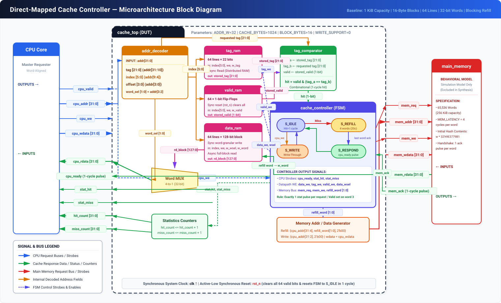

# System Architecture Block Diagram



## Overview

This diagram shows the complete architecture of the **Direct-Mapped Cache Controller** implemented in Verilog. The design is parameterized with defaults of ADDR_W=32, CACHE_BYTES=1024, and BLOCK_BYTES=16 (4 words per cache line, 64 cache lines).

## Module Hierarchy

### Top Module: `cache_top`

The dashed boundary encloses all modules instantiated within `cache_top`. The `main_memory` module is external (instantiated by the testbench).

### Sub-Modules

| Module | Color | Function |
|--------|-------|----------|
| **addr_decoder** | Amber | Splits the 32-bit `cpu_addr` into `tag` [21:0], `index` [5:0], `offset` [3:0], and `word_sel` [1:0] |
| **tag_ram** | Pink | 64-entry × 22-bit tag storage. Async read by `index`, sync write on `tag_we` |
| **valid_ram** | Pink | 64-entry × 1-bit valid-bit storage. Cleared on reset, set during refill |
| **data_ram** | Pink | 64-entry × 128-bit (4-word) block storage. Word-level writes via `w_word_sel` |
| **tag_comparator** | Green | Produces `hit = valid & (stored_tag == tag)` |
| **cache_controller** | Indigo | FSM that orchestrates all control signals |
| **Word MUX** | Yellow | Extracts the requested 32-bit word: `rd_block[word_sel*32 +: 32]` |
| **Statistics Counters** | Light green | Increment `hit_count` / `miss_count` on `stat_hit` / `stat_miss` pulses |

### Controller FSM States

```
S_IDLE ──miss──▶ S_REFILL ──done──▶ S_RESPOND ──▶ S_IDLE
  │                                                   ▲
  └──write──▶ S_WRITE ──ack────────────────────────────┘
```

- **S_IDLE**: Look up the request. Hit → respond in the same cycle. Miss → go to S_REFILL. Write (if WRITE_SUPPORT=1) → go to S_WRITE.
- **S_REFILL**: Fetch `WORDS_PER_BLOCK` words one by one via `mem_req`/`mem_ack`. Update `data_ram`, `tag_ram`, and `valid_ram`.
- **S_RESPOND**: Block is now in cache. Assert `cpu_ready` for one cycle, then return to S_IDLE.
- **S_WRITE**: Write-through to memory. Wait for `mem_ack`, then return to S_IDLE.

## Interfaces

### CPU Interface (Left Side)

| Direction | Signal | Width | Description |
|-----------|--------|-------|-------------|
| CPU → Cache | `cpu_valid` | 1 | Request valid |
| CPU → Cache | `cpu_addr` | 32 | Byte address |
| CPU → Cache | `cpu_we` | 1 | Write enable |
| CPU → Cache | `cpu_wdata` | 32 | Write data |
| Cache → CPU | `cpu_rdata` | 32 | Read data |
| Cache → CPU | `cpu_ready` | 1 | Transaction complete |
| Cache → CPU | `stat_hit` | 1 | Hit pulse |
| Cache → CPU | `stat_miss` | 1 | Miss pulse |
| Cache → CPU | `hit_count` | 32 | Cumulative hits |
| Cache → CPU | `miss_count` | 32 | Cumulative misses |

### Memory Interface (Right Side)

| Direction | Signal | Width | Description |
|-----------|--------|-------|-------------|
| Cache → Memory | `mem_req` | 1 | Memory request |
| Cache → Memory | `mem_addr` | 32 | Memory address |
| Cache → Memory | `mem_we` | 1 | Memory write enable |
| Cache → Memory | `mem_wdata` | 32 | Memory write data |
| Memory → Cache | `mem_rdata` | 32 | Memory read data |
| Memory → Cache | `mem_ack` | 1 | Memory acknowledge |

## Data Flow Summary

1. **Read Hit**: `cpu_addr` → `addr_decoder` → `index` reads all three RAMs → `tag_comparator` produces `hit=1` → `data_ram` output goes through **Word MUX** → `cpu_rdata`. All in one cycle.
2. **Read Miss**: `hit=0` → controller enters `S_REFILL` → issues `mem_req` for each word → stores via `data_ram` write port → after last word, updates `tag_ram` and `valid_ram` → `S_RESPOND` asserts `cpu_ready`.
3. **Write-Through** (when enabled): `S_IDLE` → `S_WRITE` → `mem_req` + `mem_we` → word written to memory → on hit, also written to `data_ram`. No-write-allocate on miss.
