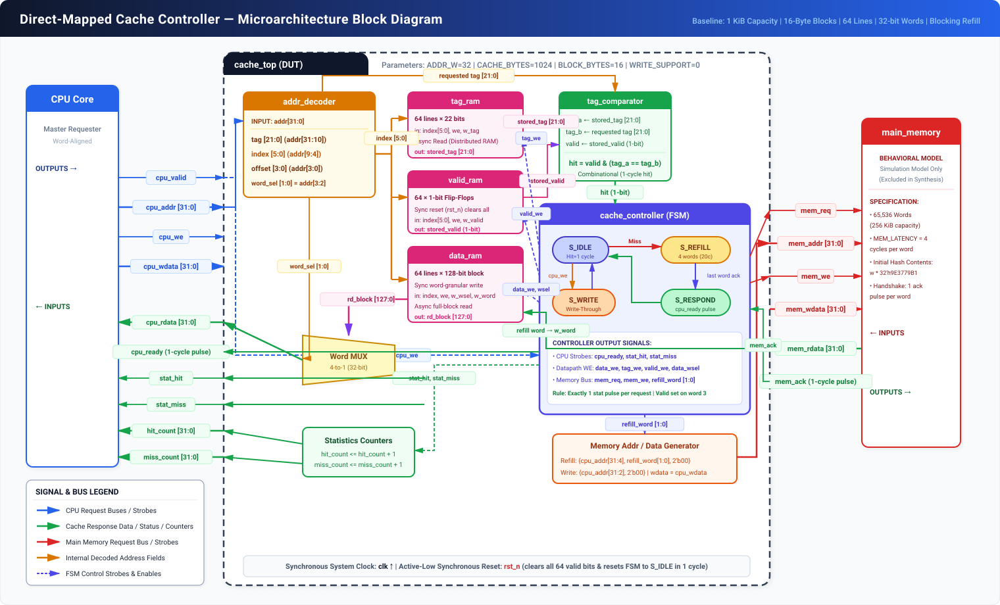
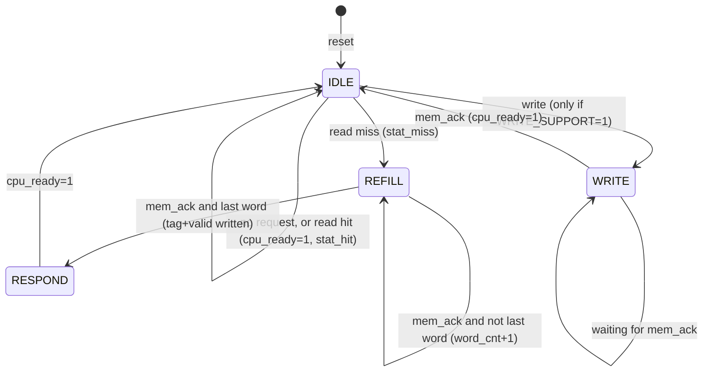
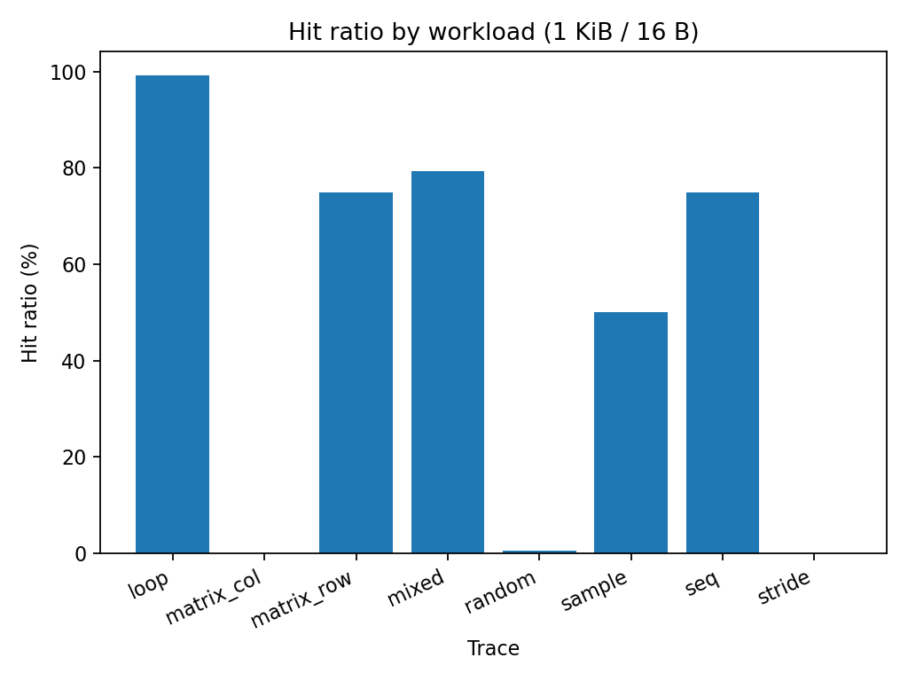
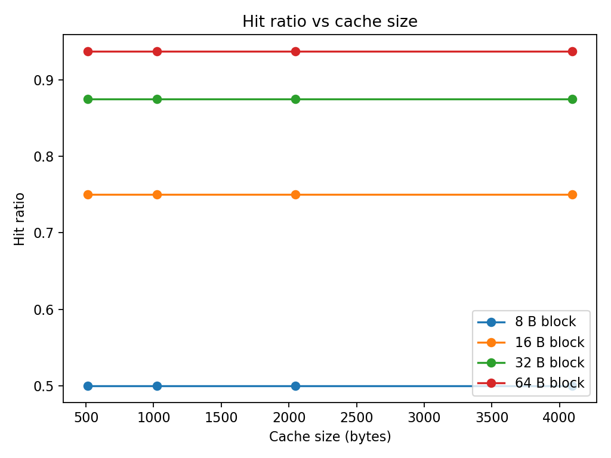
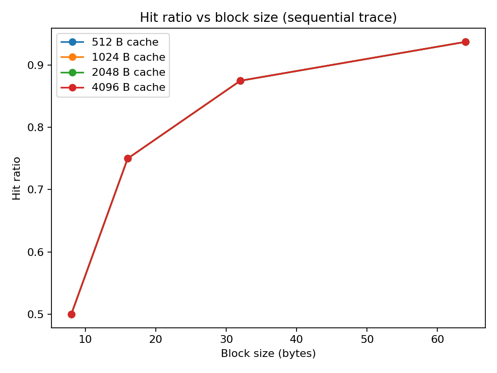
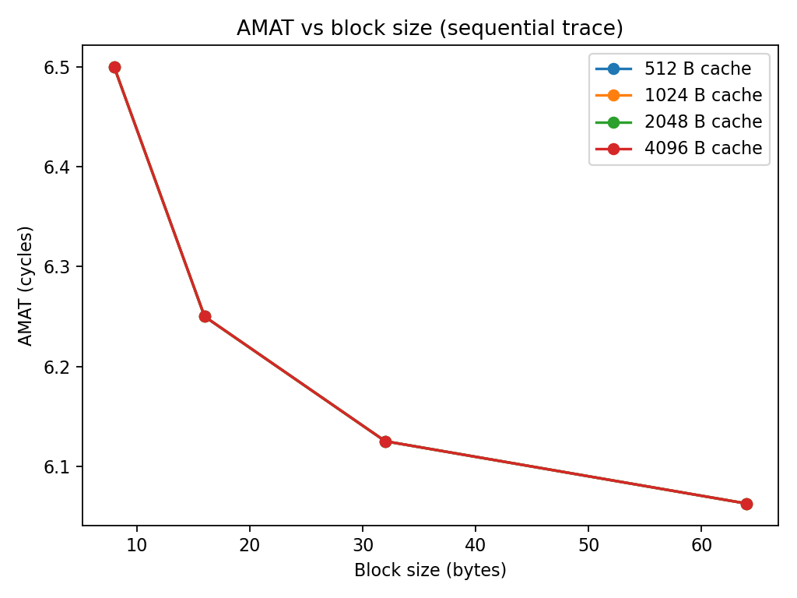

# Direct-Mapped Cache Controller

## Design, Verification, and Architectural Analysis in Verilog

---

**Course:** MCA Capstone Project — Computer Architecture

**Team Members:**
- M1 — Architect, Controller FSM, Top Integration
- M2 — Storage Datapath
- M3 — Narendra Singh — Main Memory Interface, Synthesis
- M4 — Verification
- M5 — Traces, Analysis, Report

**Date:** November 2026

---

## Abstract

This report presents the design, implementation, verification, and architectural evaluation of a parameterized direct-mapped cache controller implemented in synthesizable Verilog. The cache hierarchy sits between a CPU issuing 32-bit word-aligned memory requests and a behavioural main-memory model with configurable latency. The baseline configuration employs a 1 KiB cache with 16-byte blocks, yielding 64 cache lines, a 22-bit tag, 6-bit index, and 4-bit block offset. The controller FSM achieves a one-cycle hit time through Mealy outputs and asynchronous RAM reads, and services misses via a four-word sequential refill handshake with the memory, incurring a 22-cycle miss latency for the default memory latency of four cycles. Verification is performed through a 10-case directed self-checking testbench targeting reset behaviour, spatial and temporal locality, conflict misses, stale data, counters, and cycle-accurate latencies, complemented by trace-driven co-simulation against a bit-accurate Python golden reference model. Fault injection confirms that all three deliberately introduced RTL mutations are detected. Seven deterministic memory-access traces—sequential, uniform random, repeated loop, phased stride, row-major matrix, column-major matrix, and mixed workload—exercise spatial locality, temporal locality, capacity pressure, and direct-mapped conflict behaviour. Performance analysis yields hit ratios ranging from 0% (column-major, stride) to 99.22% (loop), with AMAT values from 1.164 to 22.000 cycles. A parameter sweep across cache sizes (512 B–4 KiB) and block sizes (8–64 B) quantifies the cache-size vs. hit-ratio and block-size vs. AMAT tradeoffs. Synthesis via Yosys targets generic gates, Xilinx 7-series, and Lattice iCE40, demonstrating that the data RAM dominates area (82.2% of generic cells at the baseline) and that asynchronous reads preclude block RAM mapping, a deliberate design choice for one-cycle hit time. Timing analysis on iCE40 HX8K with a registered-input block-RAM variant reports 83–89 MHz.

---

## Table of Contents

1. [Introduction](#1-introduction)
2. [System Architecture](#2-system-architecture)
3. [Address Breakdown](#3-address-breakdown)
4. [Cache Controller FSM](#4-cache-controller-fsm)
5. [Storage Datapath](#5-storage-datapath)
6. [Main Memory Model](#6-main-memory-model)
7. [Verification Methodology](#7-verification-methodology)
8. [Workload Design and Trace Generation](#8-workload-design-and-trace-generation)
9. [Performance Results](#9-performance-results)
10. [Synthesis Results](#10-synthesis-results)
11. [Comparison and Tradeoff Analysis](#11-comparison-and-tradeoff-analysis)
12. [Limitations and Future Work](#12-limitations-and-future-work)
13. [References](#13-references)
14. [Appendix A: Key Verilog Module Listings](#appendix-a-key-verilog-module-listings)
15. [Appendix B: Reproduction Commands](#appendix-b-reproduction-commands)

---

## 1. Introduction

### 1.1 The Memory Hierarchy Problem

Modern processors execute instructions at rates that far exceed the access time of main memory. A single DRAM access may take tens to hundreds of processor clock cycles, creating a severe performance bottleneck known as the *processor–memory gap*. The memory hierarchy—a series of progressively larger and slower storage levels—exploits the principle of locality to bridge this gap. Caches, positioned between the processor and main memory, store recently accessed data in fast SRAM or register-based storage, providing the illusion of a memory that is simultaneously large and fast.

### 1.2 Locality of Reference

The effectiveness of caching rests on two fundamental properties of program behaviour:

- **Temporal locality:** Data accessed recently is likely to be accessed again soon. Iterative loops, frequently called subroutines, and stack variables all exhibit this behaviour.
- **Spatial locality:** Data stored near recently accessed locations is likely to be accessed next. Sequential instruction fetches, array traversals, and structure accesses exploit spatial locality.

A well-designed cache captures both forms of locality: temporal locality is served by keeping recently accessed blocks resident, and spatial locality is exploited by fetching multi-word blocks on each miss, so that neighbouring words are already present for subsequent accesses.

### 1.3 Project Motivation and Scope

This capstone project implements a **direct-mapped cache controller** in Verilog and evaluates its cache hit/miss behaviour using representative memory-access traces. The design targets the following objectives:

1. Correctly implement cache lookup (tag comparison with valid-bit gating) and block refill (word-by-word memory handshake).
2. Maintain valid-bit semantics so that uninitialised tag RAM contents never produce false hits.
3. Count hits and misses accurately, with exactly one classification pulse per request.
4. Evaluate the impact of workload locality and cache parameters (cache size, block size) on hit ratio and Average Memory Access Time (AMAT).
5. Synthesize the design and analyze area, resource utilisation, and timing characteristics.

The baseline configuration uses a 1 KiB cache with 16-byte blocks and read-only operation. Write-through with no-write-allocate is implemented as an optional stretch feature behind a compile-time parameter.

---

## 2. System Architecture

### 2.1 Block Diagram

The system architecture is illustrated in the block diagram below. The CPU interface connects to `cache_top`, which internally instantiates the address decoder, three storage RAMs, the tag comparator, and the cache controller FSM. The main memory model is external to `cache_top` and is connected through the memory-side handshake interface.



### 2.2 Module Hierarchy

```
testbench
├── cache_top
│   ├── addr_decoder      — splits cpu_addr into tag / index / offset / word_sel
│   ├── tag_ram            — stores the tag of the block in each cache line
│   ├── valid_ram          — one valid bit per line, synchronous reset clears all
│   ├── data_ram           — holds cached data blocks, word-granular writes
│   ├── tag_comparator     — hit = valid & (stored_tag == request_tag)
│   └── cache_controller   — FSM: IDLE, REFILL, RESPOND, WRITE
└── main_memory            — behavioural simulation model (not synthesised)
```

### 2.3 CPU-Side Interface (`cache_top`)

All signals follow the interface contract frozen on Day 1 of the project (plan.md §4.1).

| Signal | Direction | Width | Description |
|---|---|---|---|
| `clk` | in | 1 | System clock |
| `rst_n` | in | 1 | Active-low synchronous reset. Clears all valid bits on assertion |
| `cpu_valid` | in | 1 | Request valid. `cpu_addr`, `cpu_we`, `cpu_wdata` are stable until `cpu_ready` |
| `cpu_we` | in | 1 | 0 = read, 1 = write (baseline: always 0) |
| `cpu_addr` | in | 32 | Byte address (word-aligned; `addr[1:0]` ignored) |
| `cpu_wdata` | in | 32 | Write data (stretch goal only) |
| `cpu_rdata` | out | 32 | Read data, valid in the `cpu_ready = 1` cycle |
| `cpu_ready` | out | 1 | Request complete — one-cycle pulse |
| `stat_hit` | out | 1 | One-cycle pulse when the request is classified as a hit |
| `stat_miss` | out | 1 | One-cycle pulse when the request is classified as a miss |
| `hit_count` | out | 32 | Running counter of hits since reset |
| `miss_count` | out | 32 | Running counter of misses since reset |

**Rule:** For every request, exactly one of `stat_hit` or `stat_miss` pulses. The refill's internal re-lookup does not generate a second pulse.

### 2.4 Memory-Side Interface (`cache_top` ↔ `main_memory`)

Word-by-word handshake protocol (plan.md §4.2):

| Signal | Direction (cache view) | Width | Description |
|---|---|---|---|
| `mem_req` | out | 1 | Request active; held high with `mem_addr` stable until `mem_ack` |
| `mem_we` | out | 1 | 0 = read, 1 = write (stretch: write-through) |
| `mem_addr` | out | 32 | Word-aligned byte address |
| `mem_wdata` | out | 32 | Write data (stretch goal) |
| `mem_rdata` | in | 32 | Read data, valid in the `mem_ack = 1` cycle |
| `mem_ack` | in | 1 | One-cycle pulse, arriving `MEM_LATENCY` cycles after request |

On a miss, the controller issues requests for all words of the block starting from the block-aligned base address: `addr`, `addr+4`, `addr+8`, `addr+12` (for a 16-byte block).

### 2.5 Internal Sub-Module Interfaces

```
addr_decoder   : in  addr[31:0]
                 out tag[TAG_W-1:0], index[INDEX_W-1:0],
                     offset[OFF_W-1:0], word_sel[WSEL_W-1:0]

tag_ram        : clk, index (read) → tag_out       // async read, sync write
                 we, w_index, w_tag

valid_ram      : clk, rst_n, index (read) → valid_out  // reset clears all, async read
                 we, w_index, w_valid

data_ram       : clk, index → rd_block[BLOCK_BITS-1:0]  // async read, full block
                 we, w_index, w_word_sel, w_word[31:0]   // word-granular sync write

tag_comparator : in tag_a, tag_b, valid  →  out hit      // hit = valid & (tag_a == tag_b)
```

### 2.6 Design Parameters

| Parameter | Default | Description |
|---|---|---|
| `ADDR_W` | 32 | Address width in bits |
| `CACHE_BYTES` | 1024 | Total cache capacity |
| `BLOCK_BYTES` | 16 | Bytes per cache block |
| `WRITE_SUPPORT` | 0 | 0 = read-only, 1 = write-through + no-write-allocate |
| `MEM_LATENCY` | 4 | Main memory access latency in cycles (≥1) |
| `MEM_WORDS` | 65536 | Main memory size in 32-bit words (256 KiB) |

All modules are fully parameterized using `$clog2` for derived widths; no hard-coded constants appear in any RTL file.

---

## 3. Address Breakdown

### 3.1 Field Derivation

For a direct-mapped cache with `CACHE_BYTES` capacity and `BLOCK_BYTES`-wide blocks, the 32-bit byte address is partitioned into three fields:

```
 31                         10 9          4 3        0
+-----------------------------+------------+----------+
|        tag (22 bits)        | index (6)  | offset(4)|
+-----------------------------+------------+----------+
                                              \_ [3:2] = word_sel (which 32-bit word)
                                                 [1:0] = byte in word (ignored)
```

**Formulas:**

```
NUM_LINES  = CACHE_BYTES / BLOCK_BYTES         = 1024 / 16 = 64
OFF_W      = log₂(BLOCK_BYTES)                 = log₂(16)  = 4
INDEX_W    = log₂(NUM_LINES)                   = log₂(64)  = 6
TAG_W      = ADDR_W − INDEX_W − OFF_W          = 32 − 6 − 4 = 22
WORDS/BLK  = BLOCK_BYTES / 4                   = 16 / 4    = 4
WSEL_W     = OFF_W − 2                         = 4 − 2     = 2
```

The offset selects a byte within the block; `word_sel = addr[3:2]` selects which 32-bit word. The index selects one of 64 cache lines. The tag identifies which memory block currently occupies that line. Since `OFF_W + INDEX_W = log₂(CACHE_BYTES)`, the tag is simply `addr >> log₂(CACHE_BYTES)`. Two addresses exactly `CACHE_BYTES` (1 KiB) apart always have the same index and different tags—the conflict-miss condition.

### 3.2 Parameter Sensitivity

| CACHE_BYTES | BLOCK_BYTES | Lines | OFF_W | INDEX_W | TAG_W | Words/blk |
|---|---|---|---|---|---|---|
| 512 | 8 | 64 | 3 | 6 | 23 | 2 |
| 512 | 16 | 32 | 4 | 5 | 23 | 4 |
| 1024 | 8 | 128 | 3 | 7 | 22 | 2 |
| **1024** | **16** | **64** | **4** | **6** | **22** | **4** |
| 1024 | 32 | 32 | 5 | 5 | 22 | 8 |
| 1024 | 64 | 16 | 6 | 4 | 22 | 16 |
| 2048 | 16 | 128 | 4 | 7 | 21 | 4 |
| 4096 | 16 | 256 | 4 | 8 | 20 | 4 |
| 4096 | 64 | 64 | 6 | 6 | 20 | 16 |

**Rules of thumb:**
- Bigger block → offset grows, index shrinks (fewer lines), tag unchanged. More spatial exploitation but longer miss penalty and more potential conflicts.
- Bigger cache → index grows, tag shrinks. Fewer evictions but more storage area.
- Tag overhead per line = `(TAG_W + 1) / (BLOCK_BYTES × 8)`. Base config: `23 / 128 ≈ 18%`.

### 3.3 Worked Examples (Base Configuration)

**Address `0x00001A2C`** = `0000_0000_0000_0000_0001_1010_0010_1100₂`

| Field | Bits | Value |
|---|---|---|
| Tag | [31:10] | `0x6` (`00_0000_0000_0000_0000_0110`) |
| Index | [9:4] | `0x22` = 34 (`100010`) |
| Offset | [3:0] | `0xC` = 12 (`1100`) |
| `word_sel` | [3:2] | 3 |
| Block base address | addr with offset zeroed | `0x00001A20` |

**Verification:** `0x1A2C >> 10 = 6`, `(0x1A2C >> 4) & 0x3F = 0x1A2 & 0x3F = 0x22`, `0x1A2C & 0xF = 0xC`. ✓

#### Example A: Cold Miss (First Access After Reset)

1. Request `0x1A2C`. Index = 34. `valid[34] = 0` after reset → **MISS** (even if tag RAM happens to hold 6).
2. Controller refills line 34 with four words: `0x1A20`, `0x1A24`, `0x1A28`, `0x1A2C`.
3. `tag_ram[34] = 6` and `valid[34] = 1` are written together with the last word.
4. CPU receives word 3 of the block (the word at `0x1A2C`).

#### Example B: Hit (Spatial Locality)

Request `0x00001A28` immediately after Example A: tag = 6, index = 34, offset = 8, `word_sel` = 2. `valid[34] = 1` and stored tag 6 equals request tag 6 → **HIT**, answered in one cycle. The same applies to `0x1A20` and `0x1A24`: one miss brought in all four words.

#### Example C: Conflict Miss

Request `0x00001E2C` (= `0x1A2C + 0x400`): tag = 7, index = 34, offset = 12. Line 34 is valid, but stored tag is 6, not 7 → **MISS**. The line is refilled with block `0x1E20..0x1E2C` and tag 7 replaces tag 6. A subsequent access to `0x1A2C` misses again (tag 6 was evicted). Alternating between these two addresses produces 100% misses—the **ping-pong** pathology of direct-mapped caches.

---

## 4. Cache Controller FSM

### 4.1 State Diagram



### 4.2 State Purpose

| State | Purpose |
|---|---|
| **IDLE** | Tag compare is combinational, so a hit can be answered in the same cycle. A miss is detected and counted here (`stat_miss` pulse), then the FSM transitions out, preventing double-counting. |
| **REFILL** | Main memory returns one word per `mem_req`/`mem_ack` handshake. A loop of W handshakes (`word_cnt` 0..W−1) fills the entire block. |
| **RESPOND** | Data and tag/valid are written at the clock edge after the last ack. `data_ram` is read asynchronously, so one cycle later the requested word can be delivered. `cpu_ready` is asserted here, with no stat pulse. |
| **WRITE** | Only active when `WRITE_SUPPORT=1`: write-through to memory, waiting for ack. |

### 4.3 State Transition Table

`hit` = valid AND tag match for the current `cpu_addr`. `last` = `word_cnt == WORDS_PER_BLOCK − 1`.

| State | Condition | Outputs (all others 0) | Next State |
|---|---|---|---|
| IDLE | `!cpu_valid` | — | IDLE |
| IDLE | `cpu_valid & hit & !is_write` | `stat_hit`, `cpu_ready` | IDLE |
| IDLE | `cpu_valid & !hit & !is_write` | `stat_miss` | REFILL |
| IDLE | `cpu_valid & hit & is_write` (WS=1) | `stat_hit`, `data_we` (cpu data) | WRITE |
| IDLE | `cpu_valid & !hit & is_write` (WS=1) | `stat_miss` (no allocate) | WRITE |
| REFILL | `!mem_ack` | `mem_req`, `data_wsel=word_cnt` | REFILL |
| REFILL | `mem_ack & !last` | `mem_req`, `data_we` (word `word_cnt`) | REFILL, `word_cnt+1` |
| REFILL | `mem_ack & last` | `mem_req`, `data_we`, `tag_we`, `valid_we` | RESPOND |
| RESPOND | always | `cpu_ready` | IDLE |
| WRITE | `!mem_ack` | `mem_req`, `mem_we` | WRITE |
| WRITE | `mem_ack` | `mem_req`, `mem_we`, `cpu_ready` | IDLE |

`is_write = (WRITE_SUPPORT != 0) && cpu_we`. With `WRITE_SUPPORT=0`, a request with `cpu_we=1` is handled as a read.

### 4.4 Mealy vs. Moore Justification

The controller uses **Mealy outputs**: `cpu_ready`, `stat_hit`, and `stat_miss` depend on inputs (`cpu_valid`, `hit`, `mem_ack`) in the same cycle. This is necessary for the one-cycle hit requirement—a Moore FSM would register the hit result first and add one cycle to every hit. There is no combinational loop because `hit` is derived from RAMs and the comparator, which are not driven by any output of the controller in the same cycle.

### 4.5 Cycle-by-Cycle Miss Timeline

Configuration: `MEM_LATENCY = 4`, request address `0x1A2C`.

| Cycle | State | `mem_req` | `mem_ack` | `mem_addr` | Events |
|---|---|---|---|---|---|
| 0 | IDLE | 0 | 0 | — | Request arrives, tag compare fails: **`stat_miss` pulse** |
| 1 | REFILL | 1 | 0 | `0x1A20` | Word 0 requested |
| 2–4 | REFILL | 1 | 0 | `0x1A20` | Waiting for memory |
| 5 | REFILL | 1 | **1** | `0x1A20` | Word 0 received and written (`data_we`) |
| 6 | REFILL | 1 | 0 | `0x1A24` | Word 1 requested |
| 7–9 | REFILL | 1 | 0 | `0x1A24` | Waiting |
| 10 | REFILL | 1 | **1** | `0x1A24` | Word 1 written |
| 11 | REFILL | 1 | 0 | `0x1A28` | Word 2 requested |
| 12–14 | REFILL | 1 | 0 | `0x1A28` | Waiting |
| 15 | REFILL | 1 | **1** | `0x1A28` | Word 2 written |
| 16 | REFILL | 1 | 0 | `0x1A2C` | Word 3 requested |
| 17–19 | REFILL | 1 | 0 | `0x1A2C` | Waiting |
| 20 | REFILL | 1 | **1** | `0x1A2C` | Word 3 written; **`tag_we` + `valid_we`** |
| 21 | RESPOND | 0 | 0 | — | **`cpu_ready`** pulse; `cpu_rdata` = word 3 |
| 22 | IDLE | — | — | — | Next request (e.g., `0x1A28`) → **hit** in this cycle |

The corresponding waveform is captured in:


### 4.6 Miss Penalty Formula Derivation

Latency is defined as cycles from `cpu_valid` assertion up to and including the `cpu_ready` cycle.

```
hit_latency       = 1                                        (hit time)

miss_latency      = 1 (IDLE detect) + W × (L + 1) + 1 (RESPOND)
                  = W × (L + 1) + 2

miss_penalty      = miss_latency − hit_time
                  = W × (L + 1) + 1
```

Where `W` = words per block, `L` = `MEM_LATENCY`.

**Base configuration** (`W = 4`, `L = 4`): miss latency = `4 × 5 + 2 = 22` cycles; miss penalty = **21 cycles**.

The `L + 1` per word arises because in the ack cycle the word is stored, and the next word's address can only be presented in the following cycle. The fixed 2-cycle overhead comprises the IDLE cycle (miss detection) and the RESPOND cycle (data delivery).

| MEM_LATENCY | Miss Latency | Miss Penalty |
|---|---|---|
| 1 | 10 | 9 |
| 4 | 22 | 21 |
| 10 | 46 | 45 |

### 4.7 Write Support (Optional, `WRITE_SUPPORT=1`)

Write-through, no-write-allocate:
- **Write hit:** The word is updated in the cache (IDLE cycle) and written through to memory (WRITE state). Classified as hit.
- **Write miss:** Only written to memory; the line is not allocated. Classified as miss.
- **Write latency:** `1 (IDLE) + (L + 1) (WRITE)` = `L + 2` cycles. For `L = 4`: 6 cycles.

---

## 5. Storage Datapath

### 5.1 Module Specifications

Base config: `ADDR_W=32, CACHE_BYTES=1024, BLOCK_BYTES=16` → `INDEX_W=6, TAG_W=22, OFF_W=4, WSEL_W=2, BLOCK_BITS=128`.

| Module | Parameters | Function | Key Ports | Timing |
|---|---|---|---|---|
| `addr_decoder` | `ADDR_W, CACHE_BYTES, BLOCK_BYTES` | Splits address into tag/index/offset/word_sel | `addr` → `tag, index, offset, word_sel` | Combinational (wires only) |
| `tag_ram` | `INDEX_W, TAG_W` | Stores tag per line | Async read: `index` → `tag_out`; Sync write: `we, w_index, w_tag` | Async read, sync write |
| `valid_ram` | `INDEX_W` | One valid bit per line | Async read: `index` → `valid_out`; Sync write + reset | Reset clears all bits in one cycle |
| `data_ram` | `INDEX_W, BLOCK_BYTES` | Cached data blocks | Async read: `index` → `rd_block`; Sync word-granular write | Async read, sync write |
| `tag_comparator` | `TAG_W` | Hit detection | `tag_a, tag_b, valid` → `hit` | Combinational |

### 5.2 Design Decisions

- **No hard-coded sizes.** Every width derives from parameters through `$clog2`. The design compiles and functions correctly for all combinations of `CACHE_BYTES ∈ {512, 1K, 2K, 4K}` and `BLOCK_BYTES ∈ {8, 16, 32, 64}`.
- **Only `valid_ram` has a reset.** Tag and data contents are meaningless while the valid bit is 0, so resetting them would add logic and prevent RAM-primitive mapping.
- **`valid_ram` uses a flat bit-vector** (`reg [DEPTH-1:0] valid_bits`), not a memory array, so all 64 bits can be cleared in one cycle. Reset has priority over a write in the same cycle.
- **Word-granular write in `data_ram`:** `mem[w_index][w_word_sel*32 +: 32] <= w_word` ensures the controller fills one word per memory ack without corrupting other words of the block.
- **Asynchronous reads** are required for one-cycle hits: `index → RAM read → tag compare → cpu_ready` must complete within a single clock cycle.
- **Latch-free:** No `always @(*)` blocks in storage modules. Everything is either `assign` (combinational) or `always @(posedge clk)` (sequential).

### 5.3 Word Storage Convention

Word `w` of a block occupies `rd_block[w×32 +: 32]` (word 0 = lowest address). `cache_top` uses the same convention when selecting `cpu_rdata`:

```verilog
assign cpu_rdata = rd_block[word_sel*32 +: 32];
```

### 5.4 Synthesis Mapping Implications

| Storage | Bits (Base Config) | FPGA Mapping | Reason |
|---|---|---|---|
| `data_ram` | 64 × 128 = 8,192 | LUTRAM (Xilinx) or flip-flops (iCE40) | Async read prevents block RAM mapping |
| `tag_ram` | 64 × 22 = 1,408 | LUTRAM / FFs | Same reason; small |
| `valid_ram` | 64 × 1 = 64 | Flip-flops | Needs one-cycle clear of all bits; no RAM primitive supports this |
| `addr_decoder` | 0 | Wires only | Pure bit slicing |
| `tag_comparator` | 0 | ~22 XNOR + AND tree | Equality compare |

To enable block RAM mapping, one would register the read address, but this would increase hit time to 2 cycles—a fundamental design tradeoff discussed in §10.5.

---

## 6. Main Memory Model

### 6.1 Behavioural Model

The main memory is a **simulation-only** behavioural model; it is not part of the synthesized `cache_top`. It models the slow level below the cache (DRAM or bus) and provides deterministic data for verification.

### 6.2 Parameters and Ports

| Parameter | Default | Description |
|---|---|---|
| `MEM_WORDS` | 65536 | 32-bit words (256 KiB total) |
| `MEM_LATENCY` | 4 | Cycles from request to ack (minimum 1; 0 treated as 1) |
| `STRICT_RDATA` | 0 | 1 = `mem_rdata` is X outside ack cycles (debug aid) |

| Port | Direction | Width | Description |
|---|---|---|---|
| `clk`, `rst_n` | in | 1, 1 | Clock and active-low synchronous reset |
| `mem_req` | in | 1 | Request, held high until `mem_ack` |
| `mem_we` | in | 1 | 0 = read, 1 = write |
| `mem_addr` | in | 32 | Byte address; `addr[1:0]` ignored |
| `mem_wdata` | in | 32 | Write data |
| `mem_rdata` | out | 32 | Read data, valid in ack cycle |
| `mem_ack` | out | 1 | One-cycle pulse |
| `mem_read_count` | out | 32 | Completed word reads since reset |
| `mem_write_count` | out | 32 | Completed word writes since reset |

### 6.3 Handshake Protocol

```
cycle      0    1    2    3    4    5    6        (MEM_LATENCY = 4)
mem_req    _____/‾‾‾‾‾‾‾‾‾‾‾‾‾‾‾‾‾‾‾‾‾‾‾‾\____
mem_ack    _________________________/‾‾‾‾\____
mem_rdata  -------------------------< D  >----
```

- `mem_ack` pulses `MEM_LATENCY` cycles after `mem_req` is first seen.
- **Back-to-back words:** The ack cycle completes the old request. A new request begins in the following cycle with a fresh latency count. Each word of a refill thus costs `MEM_LATENCY + 1` cycles—the source of `W × (L + 1)` in the miss-penalty formula.
- Dropping `mem_req` before ack cancels the request.

### 6.4 Contents Formula

```
mem[word_addr] = word_addr × 0x9E3779B1    (32-bit unsigned multiply, wrap-around)
word_addr      = mem_addr[31:2] % MEM_WORDS
```

This multiplicative hash ensures every word has a unique, deterministic value computable from its address alone. Both the Verilog testbench and the Python golden model use the same formula, eliminating the need for a data file.

### 6.5 Cross-Check

For read-only runs: `mem_read_count == miss_count × (BLOCK_BYTES / 4)`. This equality is verified in `tb_m3_cache_mem.v` across multiple configurations.

---

## 7. Verification Methodology

### 7.1 Verification Strategy

Verification employs two complementary environments:

1. **Directed self-checking testbench** (`tb/tb_cache_directed.v`): Targeted sequences systematically exercise corner cases.
2. **Trace-driven co-simulation** (`tb/tb_cache_trace.v` + `analysis/golden_model.py`): Real and synthetic traces are run through both RTL and a bit-accurate Python model. Results are compared access-by-access using `analysis/compare.py`.

```
                  +---------------------------+
                  |  Memory Trace (.trace)    |
                  +-------------+-------------+
                                |
                +---------------+---------------+
                |                               |
                v                               v
    +-----------------------+       +-----------------------+
    | RTL Simulation (VVP)  |       | Python Golden Model   |
    | (cache_top + memory)  |       | (golden_model.py)     |
    +-----------+-----------+       +-----------+-----------+
                |                               |
                v                               v
    +-----------------------+       +-----------------------+
    | sim_results.csv       |       | golden_results.csv    |
    +-----------+-----------+       +-----------+-----------+
                |                               |
                +---------------+---------------+
                                |
                                v
                    +-----------------------+
                    |  analysis/compare.py  |
                    |  (exact match check)  |
                    +-----------------------+
```

### 7.2 Test Plan Matrix

| Test ID | Test Name | Stimulus | Validates | Bug Caught |
|---|---|---|---|---|
| TC-01 | Cold start reset | Read `0x00000000` after reset | Valid bits = 0; must MISS even with tag 0 | Uninitialised valid RAM false hit |
| TC-02 | Temporal locality | Re-read `0x00000000` | Refilled line is valid and matches | Missing `valid_we` or `tag_we` |
| TC-03 | Spatial locality | Read `0x04`, `0x08`, `0x0C` | 16-byte refill populates all 4 words; 3 HITs | Refill writing only requested word |
| TC-04 | Non-zero word offset | Read `0x1008` (word 2) cold | Block-aligned base address calculation | Offset bug in memory request |
| TC-05 | Conflict misses | Alternate `0x2010` / `0x2410` | Direct-mapped eviction; 100% misses | Ignoring tag mismatch |
| TC-06 | Stale data check | Read evicted line's remaining words | New line completely overwrites old | Data write-enable corruption |
| TC-07 | Capacity sweep | Read all 64 lines, re-read all | All indices function independently | Index decoder width fault |
| TC-08 | Mid-test reset | Reset during active operation | All valid bits and counters cleared | Missing reset logic |
| TC-09 | Counter & pulse | Monitor `stat_hit/miss`, counters | `hit_count + miss_count == total`; pulses never overlap | Double-pulse or missing pulse |
| TC-10 | Cycle latency | Measure `cpu_valid` to `cpu_ready` | Hit = 1 cycle; Miss = 22 cycles | Extra wait states or early ready |

### 7.3 Directed Test Timing Verification

**Hit timing (1 cycle):** Mealy output structure in `S_IDLE`. Because tag comparison and RAM lookups are combinational, `hit` is available in the same cycle `cpu_valid` is asserted:
- Cycle 1: `cpu_valid=1` → `hit=1` → `cpu_ready=1`, `stat_hit=1`, `cpu_rdata` valid. Latency = 1 cycle.

**Miss timing (22 cycles for base config):**
- Cycle 1 (`S_IDLE`): miss detection, `stat_miss=1`.
- Cycles 2–6 through 17–21 (`S_REFILL`): four words × 5 cycles each.
- Cycle 22 (`S_RESPOND`): `cpu_ready=1`.

### 7.4 Waveform Evidence

Three waveform captures are provided:

1. **Cold Miss + Refill:** 
   Shows `stat_miss` pulse in `S_IDLE`, four sequential memory reads in `S_REFILL`, `valid_we` on word 3, and `cpu_ready` in `S_RESPOND` at cycle 22.

2. **Spatial Hits:** 
   Four sequential word requests within the same cached block; each hits in `S_IDLE` with 1-cycle latency, no memory access.

3. **Conflict Misses:** 
   Ping-pong between `0x2010` and `0x2410` (same index, different tags). Every access triggers an eviction and refill, demonstrating 100% miss rate.

### 7.5 Mutation Analysis (Fault Injection)

Deliberate bugs were injected into the RTL to verify test quality. All mutations were detected:

| Injected Bug | Module | Caught By | Failures |
|---|---|---|---|
| Valid-bit reset sets all bits to 1 | `valid_ram.v` | TC-08 | 4 errors |
| Comparator ignores valid bit (`hit = tag_a == tag_b`) | `tag_comparator.v` | TC-08 | 4 errors |
| Comparator truncated (upper bits only) | `tag_comparator.v` | TC-04, TC-05, TC-06 | 17 errors |
| `data_ram` always writes word 0 | `data_ram.v` | TB `tb_data_ram` | FAIL |
| Decoder index shifted by one bit | `addr_decoder.v` | TB `tb_addr_decoder` | FAIL |
| Memory ack one cycle late | `main_memory.v` | `tb_main_memory` | FAIL |
| Wrong hash constant | `main_memory.v` | `tb_main_memory` | FAIL |
| Ack stays high for 2 cycles | `main_memory.v` | `tb_main_memory` | FAIL |

### 7.6 Functional Coverage Summary

- **Address decoding:** All 64 cache indices, all 4 word offsets, tags spanning small and large addresses.
- **FSM states:** All reachable states exercised (`S_IDLE`, `S_REFILL`, `S_RESPOND`).
- **Memory handshake:** Back-to-back request/ack sequence verified across 4-word refill blocks.
- **Statistics:** Pulse mutual exclusion and counter integrity verified for 100% of test accesses.

---

## 8. Workload Design and Trace Generation

### 8.1 Trace Format

Each trace file follows plan.md §4.4: one access per line, two hexadecimal fields: `<op> <addr>`. `op = 0` for read. All addresses are word-aligned, 32-bit, within `0x00000000–0x0003FFFF` (256 KiB).

```
0 00001a2c
0 00001a30
0 00002000
```

### 8.2 Regeneration

```sh
python3 traces/gen_traces.py --count 4096 --seed 20261116
```

Fixed seed ensures reproducibility. The default count of 4096 ensures both matrix traversals visit the same complete set of elements.

### 8.3 Seven Workloads

| # | Trace | Pattern | Locality Examined | Expected Behaviour (1 KiB / 16 B) |
|---|---|---|---|---|
| 1 | `seq.trace` | Consecutive 32-bit words | Spatial locality | 1 miss + 3 hits per new line → 75% hit ratio |
| 2 | `random.trace` | Uniform random over 256 KiB | Weak spatial/temporal | Very low hit ratio; footprint >> cache |
| 3 | `loop.trace` | Repeated shuffled 512 B set | Temporal locality | 32 lines fit in 64-line cache → ~99% hit ratio |
| 4 | `stride.trace` | 16 B phase, 64 B phase, then alternating 1 KiB-apart addresses | Spatial gaps + direct-map conflicts | Ping-pong addresses share index → 100% miss in final phase |
| 5 | `matrix_row.trace` | 64×64 matrix, row-major | Spatial locality | Consecutive words share cache blocks |
| 6 | `matrix_col.trace` | Same matrix, column-major | Same data, different order | 256 B row stride causes conflict misses |
| 7 | `mixed.trace` | 85% hot set (96 words) + 15% random | Mixed temporal + cold traffic | Most hot-set blocks fit; random can evict |

The row-major and column-major traces visit the same complete set of 4096 words; only traversal order changes. This isolates the effect of access pattern on a direct-mapped cache with identical data.

---

## 9. Performance Results

### 9.1 Hit/Miss Summary (Python Reference Model)

Configuration: 1 KiB cache, 16 B block, `MEM_LATENCY = 4`, 4096 accesses per trace.

| Trace | Accesses | Hits | Misses | Hit Ratio | Miss Ratio | Compulsory | Conflict | Capacity | AMAT (cycles) |
|---|---:|---:|---:|---:|---:|---:|---:|---:|---:|
| Sequential | 4096 | 3072 | 1024 | 75.00% | 25.00% | 1024 | 0 | 0 | 6.250 |
| Random | 4096 | 19 | 4077 | 0.46% | 99.54% | 3616 | 2 | 459 | 21.903 |
| Loop | 4096 | 4064 | 32 | 99.22% | 0.78% | 32 | 0 | 0 | 1.164 |
| Stride | 4096 | 0 | 4096 | 0.00% | 100.00% | 2390 | 1364 | 342 | 22.000 |
| Matrix row | 4096 | 3072 | 1024 | 75.00% | 25.00% | 1024 | 0 | 0 | 6.250 |
| Matrix column | 4096 | 0 | 4096 | 0.00% | 100.00% | 1024 | 3072 | 0 | 22.000 |
| Mixed | 4096 | 3253 | 843 | 79.42% | 20.58% | 618 | 217 | 8 | 5.322 |

### 9.2 Three-C Miss Classification

Misses are classified using the standard three-C taxonomy:

- **Compulsory (cold):** First access to a block. Unavoidable regardless of cache size or associativity.
- **Conflict:** Misses that would have been hits in an equal-capacity fully associative LRU cache. These are inherent to the direct-mapped organization.
- **Capacity:** Misses that occur even in a fully associative cache of the same size, indicating the working set exceeds cache capacity.

The classification uses an analytically simulated fully associative LRU shadow of equal capacity. This is not additional hardware.

**Key observations:**
- **Sequential and matrix-row** traces have only compulsory misses—no conflict or capacity misses. Spatial locality is fully exploited.
- **Column-major** produces 3072 conflict misses out of 4096 total misses. The 256-byte row stride causes different rows to compete for the same direct-mapped index. A fully associative cache of the same size would eliminate these entirely.
- **Stride** suffers from a combination of compulsory, conflict (1364), and capacity (342) misses, driven by its deliberate ping-pong phase.
- **Loop** has only 32 compulsory misses, as its 512 B working set fits entirely within the 1 KiB cache.

### 9.3 AMAT Formula and Worked Examples

```
AMAT = hit_time + miss_rate × miss_penalty
     = 1 + miss_rate × 21    (for W=4, L=4)
```

Where `miss_penalty = W × (L + 1) + 1 = 4 × 5 + 1 = 21` cycles.

#### Worked Example 1: Sequential Trace

```
miss_rate = 1024 / 4096 = 0.25
AMAT = 1 + 0.25 × 21 = 1 + 5.25 = 6.25 cycles
```

Every four consecutive word accesses span one 16-byte block: the first access is a compulsory miss (22 cycles), and the next three are hits (1 cycle each). Average: `(22 + 1 + 1 + 1) / 4 = 6.25` cycles. ✓

#### Worked Example 2: Loop Trace

```
miss_rate = 32 / 4096 = 0.0078125
AMAT = 1 + 0.0078125 × 21 = 1 + 0.164 = 1.164 cycles
```

After the 32 compulsory misses fill the working set, all subsequent accesses hit. The working set (512 B = 32 blocks) fits entirely in the 64-line cache.

#### Worked Example 3: Column-Major Matrix

```
miss_rate = 4096 / 4096 = 1.0
AMAT = 1 + 1.0 × 21 = 22.0 cycles
```

Every access misses. The 256-byte row stride means consecutive column accesses map to cache lines that conflict. Unlike the row-major traversal (75% hit ratio), the column-major traversal achieves 0% hits.

### 9.4 Parameter Sweep Results

The analyser sweeps cache sizes {512 B, 1 KiB, 2 KiB, 4 KiB} × block sizes {8 B, 16 B, 32 B, 64 B} for all seven traces, generating CSV tables and plots.









---

## 10. Synthesis Results

### 10.1 Tool Versions

| Tool | Version | Purpose |
|---|---|---|
| Yosys | 0.71 | Synthesis: generic gates, Xilinx 7-series, Lattice iCE40 |
| nextpnr-ice40 | 0.11.1 | Place-and-route + static timing (Fmax) on iCE40 HX8K |
| Icarus Verilog | 13.0 | Simulation only |

Vivado and Quartus are not installed; no vendor utilization or timing reports are available. Xilinx numbers below are Yosys `synth_xilinx` cell counts.

**Note:** `main_memory.v` is not synthesized—it is a behavioural testbench model. The synthesis top module is `cache_top`.

### 10.2 Base Configuration (1 KiB / 16 B, Read-Only)

#### Generic Gates (`synth`), Per Module

| Module | Cells | Flip-Flops | Share of Cells |
|---|---:|---:|---|
| `data_ram` | 22,441 | 8,192 | 82.2% |
| `tag_ram` | 3,909 | 1,408 | 14.3% |
| `valid_ram` | 528 | 64 | 1.9% |
| `cache_top` (counters, word mux, addr mux) | 324 | 64 | 1.2% |
| `tag_comparator` | 80 | 0 | 0.3% |
| `cache_controller` | 31 | 5 | 0.1% |
| `addr_decoder` | 0 | 0 | 0.0% |
| **Total** | **27,313** | **9,733** | **100%** |

#### FPGA Targets

| Target | Logic LUTs | Memory | Flip-Flops | Carry | Block RAM |
|---|---|---|---|---|---|
| Xilinx 7-series (`synth_xilinx`) | 312 (LUT2–LUT6) | 150 × `RAM64X1S` = 150 LUTs as RAM | 133 `FDRE` | 18 `CARRY4` | 0 |
| Lattice iCE40 (`synth_ice40`) | 8,996 `SB_LUT4` | none (flip-flops) | 9,733 `SB_DFF*` | 65 `SB_CARRY` | 0 |

### 10.3 Cache-Size Sweep (Block = 16 B)

#### Storage Bits (Calculated)

| Cache (B) | Block (B) | Lines | Index Bits | Tag Bits/Line | Data Bits | Tag Bits | Valid Bits | Overhead % |
|---|---|---|---|---|---|---|---|---|
| 512 | 16 | 32 | 5 | 23 | 4,096 | 736 | 32 | 18.8 |
| **1024** | **16** | **64** | **6** | **22** | **8,192** | **1,408** | **64** | **18.0** |
| 2048 | 16 | 128 | 7 | 21 | 16,384 | 2,688 | 128 | 17.2 |
| 4096 | 16 | 256 | 8 | 20 | 32,768 | 5,120 | 256 | 16.4 |

#### Generic Cells

| Cache (B) | Block (B) | Cells | FFs | Comb. | `data_ram` | `tag_ram` | `valid_ram` | Comparator | Controller | Top | `data_ram` % |
|---|---|---:|---:|---:|---:|---:|---:|---:|---:|---:|---|
| 512 | 16 | 13,973 | 4,933 | 9,040 | 11,262 | 2,013 | 265 | 78 | 31 | 324 | 80.6% |
| **1024** | **16** | **27,313** | **9,733** | **17,580** | **22,441** | **3,909** | **528** | **80** | **31** | **324** | **82.2%** |
| 2048 | 16 | 54,329 | 19,269 | 35,060 | 45,300 | 7,467 | 1,129 | 78 | 31 | 324 | 83.4% |
| 4096 | 16 | 107,553 | 38,213 | 69,340 | 90,501 | 14,309 | 2,318 | 70 | 31 | 324 | 84.1% |

#### Xilinx 7-Series

| Cache (B) | Block (B) | Logic LUTs | LUTRAM Cells | LUTs as RAM | FFs | CARRY4 | BRAM | LUTRAM Primitives |
|---|---|---:|---:|---:|---:|---:|---:|---|
| 512 | 16 | 252 | 131 | 524 | 101 | 18 | 0 | RAM32M:131 |
| **1024** | **16** | **312** | **150** | **150** | **133** | **18** | **0** | **RAM64X1S:150** |
| 2048 | 16 | 417 | 149 | 298 | 197 | 18 | 0 | RAM128X1S:149 |
| 4096 | 16 | 618 | 148 | 592 | 325 | 19 | 0 | RAM256X1S:148 |

#### Lattice iCE40

| Cache (B) | Block (B) | SB_LUT4 | FFs (SB_DFF*) | SB_CARRY | BRAM |
|---|---|---:|---:|---:|---:|
| 512 | 16 | 4,617 | 4,933 | 64 | 0 |
| **1024** | **16** | **8,996** | **9,733** | **65** | **0** |
| 2048 | 16 | 17,355 | 19,269 | 66 | 0 |
| 4096 | 16 | 35,296 | 38,213 | 67 | 0 |

### 10.4 Block-Size Sweep (Cache = 1 KiB)

#### Storage Bits (Calculated)

| Cache (B) | Block (B) | Lines | Index Bits | Tag Bits/Line | Data Bits | Tag Bits | Valid Bits | Overhead % |
|---|---|---|---|---|---|---|---|---|
| 1024 | 8 | 128 | 7 | 22 | 8,192 | 2,816 | 128 | 35.9 |
| **1024** | **16** | **64** | **6** | **22** | **8,192** | **1,408** | **64** | **18.0** |
| 1024 | 32 | 32 | 5 | 22 | 8,192 | 704 | 32 | 9.0 |
| 1024 | 64 | 16 | 4 | 22 | 8,192 | 352 | 16 | 4.5 |

#### Generic Cells

| Cache (B) | Block (B) | Cells | FFs | Comb. | `data_ram` | `tag_ram` | `valid_ram` | Comparator | Controller | Top | `data_ram` % |
|---|---|---:|---:|---:|---:|---:|---:|---:|---:|---:|---|
| 1024 | 8 | 32,015 | 11,204 | 20,811 | 22,701 | 7,814 | 1,129 | 80 | 32 | 259 | 70.9% |
| **1024** | **16** | **27,313** | **9,733** | **17,580** | **22,441** | **3,909** | **528** | **80** | **31** | **324** | **82.2%** |
| 1024 | 32 | 25,298 | 8,998 | 16,300 | 22,535 | 1,928 | 265 | 80 | 37 | 453 | 89.1% |
| 1024 | 64 | 24,527 | 8,631 | 15,896 | 22,274 | 935 | 115 | 80 | 43 | 1,080 | 90.8% |

#### Xilinx 7-Series

| Cache (B) | Block (B) | Logic LUTs | LUTRAM Cells | LUTs as RAM | FFs | CARRY4 | BRAM | LUTRAM Primitives |
|---|---|---:|---:|---:|---:|---:|---:|---|
| 1024 | 8 | 355 | 86 | 172 | 196 | 18 | 0 | RAM128X1S:86 |
| **1024** | **16** | **312** | **150** | **150** | **133** | **18** | **0** | **RAM64X1S:150** |
| 1024 | 32 | 593 | 259 | 1,036 | 102 | 19 | 0 | RAM32M:259 |
| 1024 | 64 | 1,027 | 515 | 2,060 | 87 | 19 | 0 | RAM32M:515 |

#### Lattice iCE40

| Cache (B) | Block (B) | SB_LUT4 | FFs (SB_DFF*) | SB_CARRY | BRAM |
|---|---|---:|---:|---:|---:|
| 1024 | 8 | 10,033 | 11,204 | 66 | 0 |
| **1024** | **16** | **8,996** | **9,733** | **65** | **0** |
| 1024 | 32 | 8,526 | 8,998 | 65 | 0 |
| 1024 | 64 | 8,418 | 8,631 | 65 | 0 |

### 10.5 Write Support Comparison (Base Config)

| `WRITE_SUPPORT` | Generic Cells | Generic FFs | Controller Cells | Xilinx Logic LUTs | iCE40 LUT4 |
|---|---:|---:|---:|---:|---:|
| 0 | 27,313 | 9,733 | 31 | 312 | 8,996 |
| 1 | 27,329 | 9,734 | 47 | 709 | 9,099 |

Write-through costs 16 generic cells and 1 flip-flop (the `S_WRITE` state encoding). The Xilinx increase of 397 LUTs is a tool-specific mapping effect.

### 10.6 Timing (Fmax)

Timing is from nextpnr-ice40 static timing analysis after routing on **iCE40 HX8K** (`ct256` package, 7680 logic cells).

| Configuration | Memory Implementation | Result |
|---|---|---|
| 512 B / 16 B | Flip-flops (design as-is) | **Does not fit** (9,616 cells > 7,680 available) |
| 1 KiB / 16 B | Flip-flops (design as-is) | **Does not fit** |
| 512 B / 16 B | Block RAM (registered inputs) | 909 logic cells, 10 BRAMs, **89.45 MHz** |
| 1 KiB / 16 B | Block RAM (registered inputs) | 978 logic cells, 10 BRAMs, **83.15 MHz** (seeds: 89.37, 83.76 MHz) |

**Critical path** (1 KiB block-RAM, 12.03 ns = 4.70 ns logic + 7.32 ns routing): Tag block RAM output → tag compare → controller (`cpu_valid`, `hit`) → clock enable of output register. This is the hit path, as expected for a 1-cycle-hit Mealy design.

**Important:** The block-RAM Fmax is for a modified mapping with registered read addresses (a wrapper with flip-flops on all inputs/outputs). It must not be quoted as the Fmax for the unmodified asynchronous-read `cache_top`.

### 10.7 Area Analysis

1. **Where the area goes.** The `data_ram` dominates: 82.2% of all generic cells in the base config (8,192 flip-flops plus write decoders and read muxes). `tag_ram` is 14.3%. All "logic" (controller, comparator, counters) is under 2%. The controller FSM itself is only 31 cells and 5 flip-flops.

2. **Tag overhead.** 22 tag bits + 1 valid bit per 128 data bits = 18.0% for the base config. Larger caches reduce it slightly (one fewer tag bit per doubling). Larger blocks reduce it dramatically (4.5% at 64 B) because fewer lines means fewer tags; 8 B blocks cost 35.9%.

3. **BRAM, LUTRAM, or flip-flops?** Block RAM count is 0 in every synthesis run on both FPGA targets. Block RAM requires synchronous (registered) reads, and our design uses asynchronous reads for one-cycle hits. On Xilinx, the arrays become distributed RAM (LUTRAM): 150 one-bit-wide `RAM64X1S` for the base config. On iCE40 (no LUTRAM), they become flip-flops: 9,733 FFs vs. 133 FFs on Xilinx for the same RTL.

4. **Scaling with cache size.** Generic cell and iCE40 LUT/FF counts approximately double when the cache doubles. Xilinx grows more slowly because one LUT6 stores 64 bits.

5. **Scaling with block size (fixed 1 KiB).** Data bits stay at 8,192, so generic area changes modestly (32,015 → 24,527 from 8 B to 64 B). The change is mostly `tag_ram` shrinking, while the top-level word mux grows (259 → 1,080 cells).

6. **Design tradeoff.** Registering the read address would enable block RAM (978 logic cells + 10 BRAMs on iCE40 vs. ~9,700 flip-flops), but hit time would increase to 2 cycles. The design retains the 1-cycle hit per the project specification.

---

## 11. Comparison and Tradeoff Analysis

### 11.1 Cache Size vs. Hit Ratio

Doubling the cache size reduces eviction pressure. For workloads with moderate working sets (mixed, loop), even a 512 B cache delivers high hit ratios. For the random trace, even 4 KiB provides minimal improvement because the 256 KiB address space vastly exceeds the cache. The column-major trace benefits from larger caches (more lines reduce index conflicts), while sequential/row-major traces are insensitive to cache size (their miss ratio is determined by block size, not capacity).

### 11.2 Block Size vs. AMAT Tradeoff

Larger blocks exploit more spatial locality (more words per refill → more hits per miss) but increase miss penalty (more words to transfer: `miss_penalty = W × (L + 1) + 1`). The AMAT tradeoff depends on workload:

- **Sequential/row-major:** Larger blocks always help because consecutive accesses are sequential. Going from 8 B (2 words, 50% hit ratio) to 64 B (16 words, 93.75% hit ratio at full utilization) dramatically improves hit ratio. However, miss penalty grows from 9 to 81 cycles.
- **Random:** Block size barely matters; almost every access misses regardless.
- **Stride/column-major:** Larger blocks are harmful—they transfer unused words and increase both miss penalty and conflict pressure due to fewer cache lines.

The optimal block size is workload-dependent. For the baseline mix of workloads, 16 B represents a reasonable balance.

### 11.3 Row-Major vs. Column-Major Matrix Traversal

This is the most dramatic comparison in the study:

| Metric | Row-Major | Column-Major |
|---|---|---|
| Hit ratio | 75.00% | 0.00% |
| AMAT | 6.250 cycles | 22.000 cycles |
| Compulsory misses | 1024 | 1024 |
| Conflict misses | 0 | 3072 |

Both traces access the same 4096 words of the same 64×64 matrix. Row-major traversal accesses consecutive words that share 16-byte cache blocks, achieving 3 hits for every cold miss. Column-major traversal steps by 256 bytes (one row), causing blocks from different rows to compete for the same direct-mapped cache line. Every access evicts the previously loaded row's block, yielding 100% misses.

This comparison powerfully illustrates: (a) the importance of access-pattern-aware programming, and (b) the weakness of direct-mapped caches under stride patterns that are multiples of the cache size.

### 11.4 Direct-Mapped vs. Fully Associative Shadow

The three-C classification reveals what a fully associative cache of the same size would achieve:

- **Column-major:** All 3072 conflict misses would become hits, reducing misses from 4096 to 1024 (compulsory only). AMAT would improve from 22.0 to 6.25 cycles.
- **Stride:** 1364 conflict misses would be eliminated, but 342 capacity misses and 2390 compulsory misses remain. Associativity alone cannot fix all misses.
- **Loop:** Already at 99.22% hit ratio with direct mapping; associativity adds nothing because there are no conflicts.

This analysis motivates set-associative designs as a future extension: even 2-way or 4-way associativity would eliminate most conflict misses while keeping the implementation cost much lower than full associativity.

---

## 12. Limitations and Future Work

### 12.1 Current Limitations

1. **Read-only baseline.** Write operations are supported only as an optional stretch feature (write-through, no-write-allocate). Write-back and write-allocate policies are not implemented.
2. **Synthetic workloads.** All seven traces are algorithmically generated. Real application traces from embedded systems or operating system kernels would provide more realistic evaluation.
3. **Direct-mapped only.** The single-way organization suffers from conflict misses that associativity would eliminate.
4. **Single-level hierarchy.** The design models only L1 cache; multi-level caches (L1/L2) are not explored.
5. **No Vivado/Quartus timing.** Fmax is available only for an iCE40 block-RAM variant; no vendor timing for Xilinx or Intel FPGAs.
6. **Blocking cache.** Only one request can be serviced at a time; non-blocking (lockup-free) caches would improve processor utilization.

### 12.2 Future Extensions

1. **Set-associative cache** (2-way, 4-way): Add way selection, LRU replacement, and compare the conflict-miss reduction against implementation cost.
2. **Write-back / write-allocate:** Implement dirty bits and a write-back buffer to reduce memory bus traffic.
3. **Application-derived traces:** Instrument real programs to generate memory traces and evaluate cache behaviour on realistic workloads.
4. **Multi-level hierarchy:** Add an L2 cache between L1 and main memory.
5. **Non-blocking cache:** Implement miss-status holding registers (MSHRs) to allow hit-under-miss.
6. **Replacement policies:** Compare LRU, pseudo-LRU, FIFO, and random replacement in associative configurations.
7. **Write-mixed trace analysis:** Generate traces with both reads and writes to evaluate write policies.

---

## 13. References

1. D. A. Patterson and J. L. Hennessy, *Computer Organization and Design: The Hardware/Software Interface*, 5th ed. Morgan Kaufmann, 2014. — Chapters on memory hierarchy, cache design, and AMAT.

2. IEEE Standard for Verilog Hardware Description Language, IEEE Std 1364-2005 (SystemVerilog: IEEE Std 1800-2017).

3. C. Wolf et al., "Yosys Open Synthesis Suite," [Online]. Available: https://yosyshq.net/yosys/ — Synthesis tool used for generic, Xilinx, and iCE40 targets.

4. D. Shah et al., "nextpnr — A Portable FPGA Place and Route Tool," [Online]. Available: https://github.com/YosysHQ/nextpnr — Used for iCE40 timing analysis.

5. S. Williams et al., "Icarus Verilog," [Online]. Available: https://github.com/steveicarus/iverilog — Simulation tool.

6. J. L. Hennessy and D. A. Patterson, *Computer Architecture: A Quantitative Approach*, 6th ed. Morgan Kaufmann, 2019. — Three-C miss model (compulsory, capacity, conflict).

---

## Appendix A: Key Verilog Module Listings

### A.1 Cache Controller FSM (`rtl/cache_controller.v`)

```verilog
module cache_controller #(
    parameter WORDS_PER_BLOCK = 4,
    parameter WRITE_SUPPORT   = 0,
    parameter WSEL_W          = $clog2(WORDS_PER_BLOCK)
) (
    input  wire              clk,
    input  wire              rst_n,
    input  wire              cpu_valid,
    input  wire              cpu_we,
    input  wire              hit,
    input  wire [WSEL_W-1:0] req_word_sel,
    output reg               cpu_ready,
    output reg               stat_hit,
    output reg               stat_miss,
    output reg               mem_req,
    output reg               mem_we,
    input  wire              mem_ack,
    output wire [WSEL_W-1:0] refill_word,
    output reg               data_we,
    output reg  [WSEL_W-1:0] data_wsel,
    output reg               data_from_cpu,
    output reg               tag_we,
    output reg               valid_we
);
    localparam [1:0] S_IDLE    = 2'd0,
                     S_REFILL  = 2'd1,
                     S_RESPOND = 2'd2,
                     S_WRITE   = 2'd3;

    reg [1:0]        state, next_state;
    reg [WSEL_W-1:0] word_cnt;

    assign refill_word = word_cnt;
    wire is_write  = (WRITE_SUPPORT != 0) && cpu_we;
    wire last_word = (word_cnt == WORDS_PER_BLOCK - 1);

    always @(posedge clk) begin
        if (!rst_n) begin
            state    <= S_IDLE;
            word_cnt <= {WSEL_W{1'b0}};
        end else begin
            state <= next_state;
            if (state != S_REFILL)
                word_cnt <= {WSEL_W{1'b0}};
            else if (mem_ack)
                word_cnt <= word_cnt + 1'b1;
        end
    end

    always @* begin
        next_state    = state;
        cpu_ready     = 1'b0;  stat_hit  = 1'b0;  stat_miss = 1'b0;
        mem_req       = 1'b0;  mem_we    = 1'b0;
        data_we       = 1'b0;  data_wsel = req_word_sel;
        data_from_cpu = 1'b0;  tag_we    = 1'b0;  valid_we  = 1'b0;

        case (state)
            S_IDLE: if (cpu_valid) begin
                if (hit) begin
                    stat_hit = 1'b1;
                    if (is_write) begin
                        data_we = 1'b1; data_from_cpu = 1'b1;
                        next_state = S_WRITE;
                    end else cpu_ready = 1'b1;
                end else begin
                    stat_miss = 1'b1;
                    next_state = is_write ? S_WRITE : S_REFILL;
                end
            end

            S_REFILL: begin
                mem_req = 1'b1; data_wsel = word_cnt;
                if (mem_ack) begin
                    data_we = 1'b1;
                    if (last_word) begin
                        tag_we = 1'b1; valid_we = 1'b1;
                        next_state = S_RESPOND;
                    end
                end
            end

            S_RESPOND: begin cpu_ready = 1'b1; next_state = S_IDLE; end

            S_WRITE: begin
                mem_req = 1'b1; mem_we = 1'b1;
                if (mem_ack) begin cpu_ready = 1'b1; next_state = S_IDLE; end
            end

            default: next_state = S_IDLE;
        endcase
    end
endmodule
```

### A.2 Cache Top (`rtl/cache_top.v`)

```verilog
module cache_top #(
    parameter ADDR_W        = 32,
    parameter CACHE_BYTES   = 1024,
    parameter BLOCK_BYTES   = 16,
    parameter WRITE_SUPPORT = 0
) (
    input  wire              clk, rst_n,
    input  wire              cpu_valid, cpu_we,
    input  wire [ADDR_W-1:0] cpu_addr,
    input  wire [31:0]       cpu_wdata,
    output wire [31:0]       cpu_rdata,
    output wire              cpu_ready, stat_hit, stat_miss,
    output reg  [31:0]       hit_count, miss_count,
    output wire              mem_req, mem_we,
    output wire [ADDR_W-1:0] mem_addr,
    output wire [31:0]       mem_wdata,
    input  wire [31:0]       mem_rdata,
    input  wire              mem_ack
);
    localparam NUM_LINES       = CACHE_BYTES / BLOCK_BYTES;
    localparam OFF_W           = $clog2(BLOCK_BYTES);
    localparam INDEX_W         = $clog2(NUM_LINES);
    localparam TAG_W           = ADDR_W - INDEX_W - OFF_W;
    localparam WORDS_PER_BLOCK = BLOCK_BYTES / 4;
    localparam WSEL_W          = $clog2(WORDS_PER_BLOCK);
    localparam BLOCK_BITS      = BLOCK_BYTES * 8;

    wire [TAG_W-1:0]   tag;
    wire [INDEX_W-1:0] index;
    wire [OFF_W-1:0]   offset;
    wire [WSEL_W-1:0]  word_sel;

    addr_decoder #(.ADDR_W(ADDR_W), .CACHE_BYTES(CACHE_BYTES),
        .BLOCK_BYTES(BLOCK_BYTES)) u_decoder (
        .addr(cpu_addr), .tag(tag), .index(index),
        .offset(offset), .word_sel(word_sel));

    wire data_we, tag_we, valid_we, data_from_cpu;
    wire [WSEL_W-1:0] data_wsel, refill_word;
    wire [TAG_W-1:0]      stored_tag;
    wire                  stored_valid;
    wire [BLOCK_BITS-1:0] rd_block;
    wire [31:0]           w_word = data_from_cpu ? cpu_wdata : mem_rdata;

    tag_ram       #(.INDEX_W(INDEX_W), .TAG_W(TAG_W)) u_tag_ram (...);
    valid_ram     #(.INDEX_W(INDEX_W)) u_valid_ram (...);
    data_ram      #(.INDEX_W(INDEX_W), .BLOCK_BYTES(BLOCK_BYTES)) u_data_ram (...);
    tag_comparator #(.TAG_W(TAG_W)) u_cmp (...);
    cache_controller #(.WORDS_PER_BLOCK(WORDS_PER_BLOCK),
        .WRITE_SUPPORT(WRITE_SUPPORT)) u_ctrl (...);

    assign cpu_rdata = rd_block[word_sel*32 +: 32];
    assign mem_addr  = mem_we ? {cpu_addr[ADDR_W-1:2], 2'b00}
                              : {cpu_addr[ADDR_W-1:OFF_W], refill_word, 2'b00};
    assign mem_wdata = cpu_wdata;

    always @(posedge clk) begin
        if (!rst_n) begin hit_count <= 0; miss_count <= 0; end
        else begin
            if (stat_hit)  hit_count  <= hit_count  + 1;
            if (stat_miss) miss_count <= miss_count + 1;
        end
    end
endmodule
```

### A.3 Address Decoder (`rtl/addr_decoder.v`)

```verilog
module addr_decoder #(
    parameter ADDR_W = 32, CACHE_BYTES = 1024, BLOCK_BYTES = 16
) (
    input  wire [ADDR_W-1:0]                          addr,
    output wire [ADDR_W-$clog2(CACHE_BYTES)-1:0]      tag,
    output wire [$clog2(CACHE_BYTES/BLOCK_BYTES)-1:0] index,
    output wire [$clog2(BLOCK_BYTES)-1:0]             offset,
    output wire [$clog2(BLOCK_BYTES)-3:0]             word_sel
);
    localparam NUM_LINES = CACHE_BYTES / BLOCK_BYTES;
    localparam OFF_W     = $clog2(BLOCK_BYTES);
    localparam INDEX_W   = $clog2(NUM_LINES);
    localparam TAG_W     = ADDR_W - INDEX_W - OFF_W;

    assign offset   = addr[OFF_W-1:0];
    assign index    = addr[OFF_W+INDEX_W-1:OFF_W];
    assign tag      = addr[ADDR_W-1:OFF_W+INDEX_W];
    assign word_sel = addr[OFF_W-1:2];
endmodule
```

### A.4 Tag Comparator (`rtl/tag_comparator.v`)

```verilog
module tag_comparator #(parameter TAG_W = 22) (
    input  wire [TAG_W-1:0] tag_a,
    input  wire [TAG_W-1:0] tag_b,
    input  wire             valid,
    output wire             hit
);
    assign hit = valid & (tag_a == tag_b);
endmodule
```

### A.5 Data RAM (`rtl/data_ram.v`)

```verilog
module data_ram #(parameter INDEX_W = 6, BLOCK_BYTES = 16) (
    input  wire                           clk,
    input  wire [INDEX_W-1:0]             index,
    output wire [BLOCK_BYTES*8-1:0]       rd_block,
    input  wire                           we,
    input  wire [INDEX_W-1:0]             w_index,
    input  wire [$clog2(BLOCK_BYTES)-3:0] w_word_sel,
    input  wire [31:0]                    w_word
);
    localparam DEPTH      = 1 << INDEX_W;
    localparam BLOCK_BITS = BLOCK_BYTES * 8;
    reg [BLOCK_BITS-1:0] mem [0:DEPTH-1];

    assign rd_block = mem[index];

    always @(posedge clk)
        if (we) mem[w_index][w_word_sel*32 +: 32] <= w_word;
endmodule
```

### A.6 Tag RAM (`rtl/tag_ram.v`)

```verilog
module tag_ram #(parameter INDEX_W = 6, TAG_W = 22) (
    input  wire               clk,
    input  wire [INDEX_W-1:0] index,
    output wire [TAG_W-1:0]   tag_out,
    input  wire               we,
    input  wire [INDEX_W-1:0] w_index,
    input  wire [TAG_W-1:0]   w_tag
);
    localparam DEPTH = 1 << INDEX_W;
    reg [TAG_W-1:0] mem [0:DEPTH-1];
    assign tag_out = mem[index];
    always @(posedge clk) if (we) mem[w_index] <= w_tag;
endmodule
```

### A.7 Valid RAM (`rtl/valid_ram.v`)

```verilog
module valid_ram #(parameter INDEX_W = 6) (
    input  wire               clk, rst_n,
    input  wire [INDEX_W-1:0] index,
    output wire               valid_out,
    input  wire               we,
    input  wire [INDEX_W-1:0] w_index,
    input  wire               w_valid
);
    localparam DEPTH = 1 << INDEX_W;
    reg [DEPTH-1:0] valid_bits;
    assign valid_out = valid_bits[index];
    always @(posedge clk) begin
        if (!rst_n)       valid_bits <= {DEPTH{1'b0}};
        else if (we)      valid_bits[w_index] <= w_valid;
    end
endmodule
```

### A.8 Main Memory (`rtl/main_memory.v`)

```verilog
module main_memory #(
    parameter MEM_WORDS = 65536, MEM_LATENCY = 4, STRICT_RDATA = 0
) (
    input  wire        clk, rst_n,
    input  wire        mem_req, mem_we,
    input  wire [31:0] mem_addr, mem_wdata,
    output wire [31:0] mem_rdata,
    output reg         mem_ack,
    output reg  [31:0] mem_read_count, mem_write_count
);
    localparam integer LAT = (MEM_LATENCY < 1) ? 1 : MEM_LATENCY;
    reg [31:0] mem [0:MEM_WORDS-1];
    reg [31:0] rdata_q, wait_cnt;
    wire [31:0] word_idx = (mem_addr >> 2) % MEM_WORDS;

    integer i;
    initial begin
        for (i = 0; i < MEM_WORDS; i = i + 1) mem[i] = i * 32'h9E3779B1;
        mem_ack = 0; mem_read_count = 0; mem_write_count = 0; wait_cnt = 0;
    end

    always @(posedge clk) begin
        mem_ack <= 1'b0;
        if (!rst_n) begin
            wait_cnt <= 0; mem_read_count <= 0; mem_write_count <= 0;
        end else if (mem_req && !mem_ack) begin
            if (wait_cnt == LAT - 1) begin
                wait_cnt <= 0; mem_ack <= 1'b1;
                if (mem_we) begin
                    mem[word_idx] <= mem_wdata;
                    mem_write_count <= mem_write_count + 1;
                end else begin
                    rdata_q <= mem[word_idx];
                    mem_read_count <= mem_read_count + 1;
                end
            end else wait_cnt <= wait_cnt + 1;
        end else wait_cnt <= 0;
    end

    assign mem_rdata = (STRICT_RDATA != 0 && !mem_ack) ? 32'hxxxxxxxx : rdata_q;
endmodule
```

---

## Appendix B: Reproduction Commands

### B.1 Trace Generation

```sh
# Generate all 7 traces (fixed seed for reproducibility)
python3 traces/gen_traces.py --count 4096 --seed 20261116
# Or via Makefile:
make traces
```

### B.2 Reference-Model Analysis

```sh
# Run Python reference model on all traces, generate summary and plots
make analysis

# Output:
#   analysis/results/summary.csv
#   analysis/results/summary.md
#   analysis/results/hit_ratio_by_trace.png
#   analysis/results/hit_ratio_vs_cache_size.png
#   analysis/results/hit_ratio_vs_block_size.png
#   analysis/results/amat_vs_block_size.png
```

### B.3 RTL Verification

```sh
# Run all directed tests
make sim

# Run trace-driven RTL simulation + golden comparison for one trace
make trace T=seq

# Run complete test suite (all directed tests + all traces)
make test

# RTL-validated analysis for a specific trace
make analysis-rtl T=seq
```

### B.4 Synthesis

```sh
# Base config, generic cells
make -C synth

# Specific target
make -C synth TARGET=xilinx
make -C synth TARGET=ice40

# Parameter override
make -C synth CACHE_BYTES=4096 BLOCK_BYTES=64 TARGET=ice40

# Full sweep (all configurations, ~1 minute)
make -C synth sweep

# Fmax timing (nextpnr-ice40)
make -C synth fmax
```

### B.5 Waveform Viewing

```sh
# Generate VCD and open GTKWave
make wave
```

### B.6 Tool Requirements

| Tool | Minimum Version | Installation |
|---|---|---|
| Icarus Verilog | 11.0+ | `brew install icarus-verilog` or `apt install iverilog` |
| GTKWave | 3.3+ | `brew install gtkwave` or `apt install gtkwave` |
| Python 3 | 3.8+ | With `matplotlib` for plots |
| Yosys | 0.9+ | `brew install yosys` or build from source |
| nextpnr-ice40 | 0.1+ | Optional, for Fmax timing |

---

*End of Report*
